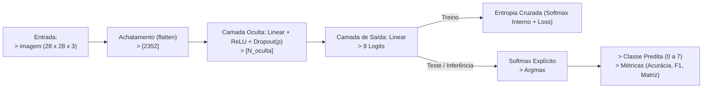

### Decisões Fixadas de Projeto (MLP)

| Configuração | Escolha / Valor | Justificativa |
| :--- | :--- | :--- |
| **Dimensão de Entrada** | $2352$ neurônios | Achatamento (*Flatten*) da imagem colorida de $28 \times 28 \times 3$ pixels. |
| **Pré-processamento** | Escalonamento em $[0.0, 1.0]$ | Divisão dos pixels por $255$ para manter os valores em escala adequada. |
| **Nº de Camadas Ocultas** | Exatamente $1$ camada | Exigência da atividade. |
| **Ativação Intermediária** | ReLU ($\max(0, x)$) | Evita o desvanecimento de gradientes e possui baixo custo computacional. |
| **Camada de Saída** | $8$ neurônios (*Logits* brutos) | Corresponde às 8 classes de células sanguíneas, sem ativação no *forward*. |
| **Função de Custo** | Entropia Cruzada Multiclasse | Aplica o Softmax internamente com estabilidade numérica. |
| **Otimizador** | Adam | Algoritmo com taxas de aprendizado adaptativas e rápida convergência. |
| **Regularização $L_2$** | weight_decay = $10^{-4}$ | Valor fixado para restringir a magnitude dos pesos e evitar *overfitting*. |
| **Número de Épocas** | $20$ épocas | Garante iterações suficientes para a convergência das curvas de perda. |
| **Tamanho do Lote (*Batch Size*)** | $256$ amostras | Equilibra a velocidade de processamento na CPU e a estabilidade da estimativa do gradiente. |

### Hiperparâmetros Explorados na Validação (MLP)

| Hiperparâmetro | Valores Candidatos | Propósito da Exploração |
| :--- | :--- | :--- |
| **Neurônios Ocultos ($N_{\text{oculta}}$)** | $\{128, 256, 512\}$ | Avaliar o impacto da capacidade de representação e complexidade da rede. |
| **Taxa de Aprendizado ($\eta$)** | $\{10^{-3}, 10^{-4}\}$ | Controlar o tamanho do passo de atualização dos pesos pelo otimizador. |
| **Probabilidade de Dropout ($p$)** | $\{0.0, 0.2, 0.3, 0.5\}$ | Investigar o efeito da inativação aleatória de neurônios na generalização. |

---
---
---

### Tabela - Decisões Fixadas de Projeto (CNN)

| Configuração | Escolha / Valor | Justificativa Metodológica |
| :--- | :--- | :--- |
| **Formato de Entrada** | Tensor $3 \times 28 \times 28$ | Preserva a topologia espacial e os 3 canais de cor (RGB) das imagens do BloodMNIST sem achatar os pixels na entrada. |
| **Pré-processamento** | Escalonamento em $[0.0, 1.0]$ | Divisão dos pixels por $255.0$ (via `ToTensor()`), mantendo exatamente a mesma normalização da MLP para comparabilidade direta. |
| **Nº de Camadas Convolucionais** | Exatamente $1$ camada | Exigência da atividade. |
| **Ativação Convolucional** | ReLU ($\max(0, x)$) | Não linearidade simples aplicada aos *feature maps*, mantendo consistência com a ativação da camada oculta da MLP. |
| **Estratégia de Padding** | *Same Padding* ($P = \frac{k-1}{2}$) | Adiciona bordas de zeros ($P=1$ para $k=3$; $P=2$ para $k=5$; $P=3$ para $k=7$). Mantém a resolução em $28 \times 28$ após a convolução para qualquer $k$, isolando o impacto do campo receptivo do kernel e mantendo fixa a dimensão de entrada do *Flatten*. |
| **Passo da Convolução (*Stride*)** | $S = 1$ | Garante a varredura contínua de todos os pixels vizinhos sem perda prematura de resolução espacial. |
| **Subamostragem (*Pooling*)** | Max-Pooling $2 \times 2$ ($S = 2$) | Pooling pequeno pois a resolução da imagem já é baixa. Seleciona a ativação máxima em janelas $2 \times 2$, reduzindo a resolução espacial exatamente pela metade ($28 \times 28 \to 14 \times 14$). Confere invariância local a pequenas translações e reduz em $75\%$ o número de conexões para a camada densa. |
| **Camada de Saída** | Linear (`nn.Linear`) | Conecta os $K \times 14 \times 14$ valores achatados (*Flatten*) diretamente aos $8$ *logits* brutos (sem Softmax no *forward*). |
| **Função de Custo** | Entropia Cruzada Multiclasse | Aplica o Softmax internamente com estabilidade numérica (`nn.CrossEntropyLoss()`). |
| **Otimizador & Regularização $L_2$** | Adam com `weight_decay` = $10^{-4}$ | Otimizador adaptativo idêntico ao da MLP, com penalização $L_2$ para restringir a magnitude dos pesos e conter o *overfitting*. |
| **Taxa de Aprendizado ($\eta$)** | $10^{-3}$ | Mantida constante e idêntica à melhor taxa obtida no Item A. |
| **Tamanho do Lote (*Batch Size*)** | $64$ amostras | Mantido idêntico ao Item A para assegurar a mesma frequência de atualização de gradientes e ruído de regularização. |
| **Número de Épocas** | $20$ épocas | Garante tempo suficiente para convergência do treino, permitindo comparação justa entre todas as 12 combinações da grade. |

### Tabela - Hiperparâmetros Explorados na Validação (CNN)

| Hiperparâmetro | Valores Candidatos | Propósito da Exploração e Justificativa dos Intervalos |
| :--- | :--- | :--- |
| **Quantidade de Kernels ($K$)** | $\{8, 16, 32, 64\}$ | **Capacidade e Extratividade de Atributos:** Avalia a quantidade de filtros/detectores de características aprendidos em paralelo (profundidade do tensor de saída). A escolha em progressão geométrica em potências de 2 ($2^3$ a $2^6$) abrange desde uma representação minimalista ($K=8$, com baixíssimo custo computacional e menos parâmetros na camada final) até uma representação altamente expressiva e redundante ($K=64$, capaz de capturar múltiplos gradientes, texturas citoplasmáticas e variações de cor dos leucócitos). |
| **Tamanho do Kernel ($k \times k$)** | $\{3 \times 3, 5 \times 5, 7 \times 7\}$ | **Escala do Campo Receptivo Local (*Receptive Field*):** Determina a área da imagem examinada por cada filtro por vez. Como a imagem possui apenas $28 \times 28$ pixels, a escolha de números ímpares pequenos/médios cobre faixas estratégicas do diâmetro celular: • **$3 \times 3$ ($\approx 10,7\%$ da largura):** Foca na extração de detalhes microscópicos finos (grânulos citoplasmáticos e bordas afiadas). • **$5 \times 5$ ($\approx 17,9\%$ da largura):** Captura padrões de escala intermediária (transições núcleo-citoplasma). • **$7 \times 7$ ($\approx 25,0\%$ da largura):** Captura estruturas macro (formato global e curvatura do núcleo). Kernels maiores que $7 \times 7$ foram descartados por cobrirem mais de $25\%$ da imagem em um único passo, destruindo a localidade espacial inerente às convoluções. |