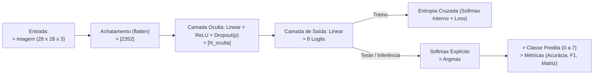
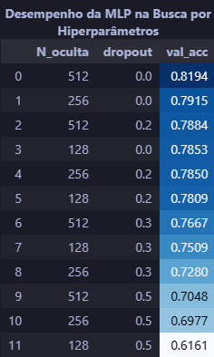
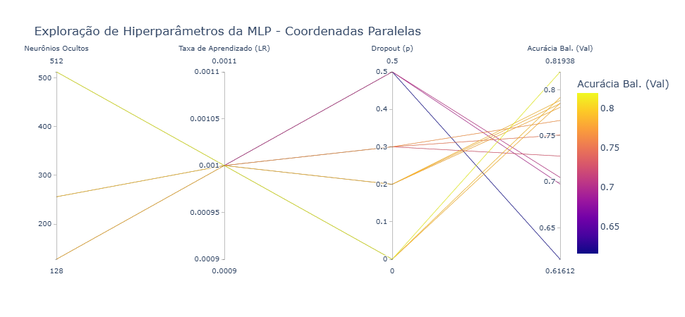

# IA048 - Atividade 3 - Redes Neurais Artificiais: MLPs e CNNs

Prof. Levy Boccato

**Aluno:** Rafael Campideli Hoyos (175100).

---

## Introdução

Para a realização da atividade foram usadas ferramentas python, destacando o uso de `PyTorch` [[2]](#referências) e `Scikit-Learn` [[3]](#referências) (para treino dos modelos e obtenção de métricas) e `Plotly` [[4]](#referências) (para plotagens de gráficos e tabelas). Os códigos e demais arquivos utilizados/confeccionados neste trabalho foram organizados em uma estrutura simplificada da *Cookiecutter Data Science* [[5]](#referências)  e estão disponíveis no *GitHub* no repositório [**TochaFh/IA048-ML-Atividades**](https://github.com/TochaFh/IA048-ML-Atividades) [[1]](#referências).

---

## Item A

Foi projetada uma MLP com exatamente uma camada oculta para classificar as 8 classes do BloodMNIST (imagens 28×28×3, partições oficiais de treino/validação/teste: 11.959/1.712/3.421). Cada configuração do grid de hiperparâmetros foi treinada por 20 épocas com Adam e entropia cruzada, e comparada pela acurácia balanceada na validação, métrica escolhida porque as classes são desbalanceadas.

O projeto da MLP pode ser resumido em duas tabelas: decisões / hiper parâmetros fixados e explorados.

#### Tabela -  Decisões Fixadas de Projeto (MLP):

| Configuração | Escolha / Valor | Justificativa |
| :--- | :--- | :--- |
| **Dimensão de Entrada** | $2352$ neurônios | Achatamento (*Flatten*) da imagem colorida de $28 \times 28 \times 3$ pixels. |
| **Pré-processamento** | Escalonamento em $[0.0, 1.0]$ | Divisão dos pixels por $255$. Mantém as entradas em faixa limitada, o que estabiliza a otimização com a inicialização padrão do PyTorch. Não foi aplicada normalização por média/desvio.|
| **Nº de Camadas Ocultas** | Exatamente $1$ camada | Exigência da atividade. |
| **Ativação Intermediária** | ReLU ($\max(0, x)$) | Não linearidade simples e barata, com gradiente 1 para x > 0, o que mitiga o desvanecimento de gradiente em relação a sigmoide/tanh. |
| **Camada de Saída** | $8$ neurônios (*Logits* brutos) | Corresponde às 8 classes de células sanguíneas, sem ativação no *forward*. |
| **Função de Custo** | Entropia Cruzada Multiclasse | Aplica o Softmax internamente com estabilidade numérica. |
| **Otimizador** | Adam | Algoritmo com taxas de aprendizado adaptativas e rápida convergência. |
| **Regularização $L_2$** | weight_decay = $10^{-4}$ | É o valor usual para o Adam no PyTorch (deve restringir a magnitude dos pesos e evitar *overfitting*) |
| **Taxa de Aprendizado ($\eta$)** | $10^{-3}$ | Em uma exploração preliminar, $10^{-4}$ teve um desempenho pior em todos os casos testados, provavelmente por convergência lenta em 20 épocas. Para reduzir o tamanho da busca, então, optou-se por fixar $10^{-3}$. |
| **Número de Épocas** | $20$ épocas | Compromisso entre custo computacional (12 configurações) e convergência com $\eta = 10^{-3}$. A melhor época é escolhida pela acurácia balanceada de validação. |
| **Tamanho do Lote (*Batch Size*)** | $64$ amostras | Lotes pequenos dão mais atualizações por época e o ruído do gradiente atua como regularização leve, o que favorece a convergência em apenas 20 épocas. |

### Tabela - Hiperparâmetros Explorados na Validação (MLP)

| Hiperparâmetro | Valores Candidatos | Propósito da Exploração |
| :--- | :--- | :--- |
| **Neurônios Ocultos ($N_{\text{oculta}}$)** | $\{128, 256, 512\}$ | Avaliar o impacto da capacidade de representação e complexidade da rede. |
| **Probabilidade de Dropout ($p$)** | $\{0.0, 0.2, 0.3, 0.5\}$ | Investigar o efeito da inativação aleatória de neurônios na generalização. |

#### Diagrama da MLP

Para melhor entender a MLP projetada veja o diagrama abaixo:

### Validação

A tabela e o gráfico mostram o desempenho das 12 configurações:

  
  

\
A melhor configuração foi N_oculta = 512, dropout = 0 (acurácia balanceada de validação 0,8194). Observa-se que:

### Teste

[imagem matriz de confusão e métricas (acc bal. e f1)]

[Análise dos resultados]

---

## Referências

1. TochaFh/IA048-ML-Atividades (repositório com as atividades na disciplina IA048 em 2s2026) https://github.com/TochaFh/IA048-ML-Atividades
2. Paszke et al., PyTorch: An Imperative Style, High-Performance Deep Learning Library, NeurIPS 2019. Também falta citar o BloodMNIST (Yang et al., MedMNIST v2, Scientific Data, 2023).
3. Scikit-learn: Machine Learning in Python, Pedregosa et al., JMLR 12, pp. 2825-2830, 2011. https://scikit-learn.org/stable/
4. Plotly-express. https://plotly.com/python/plotly-express/
5. Cookiecutter Data Science. https://cookiecutter-data-science.drivendata.org/
