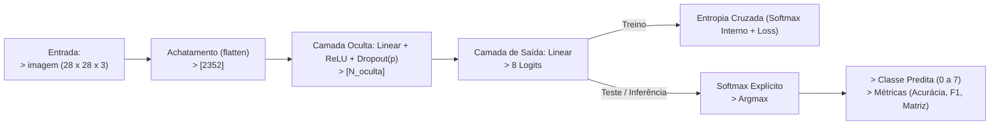
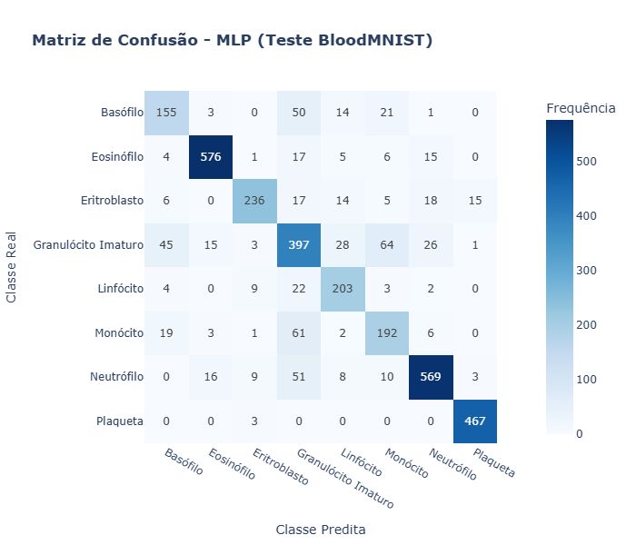
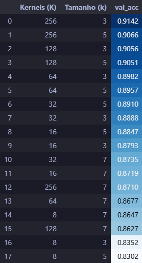
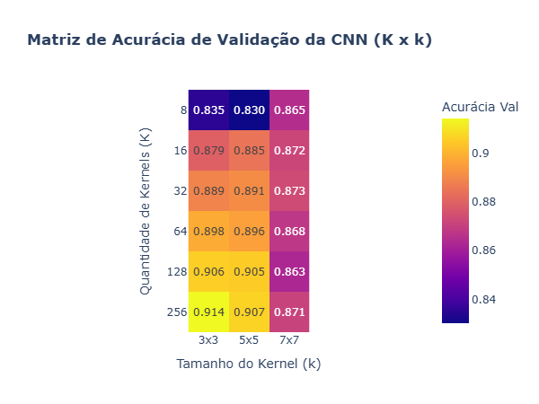
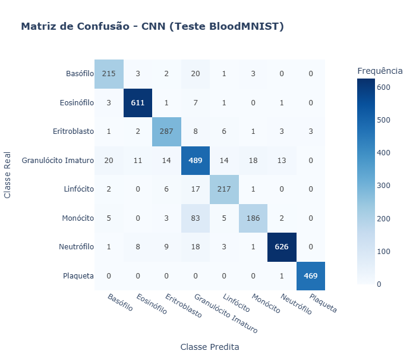
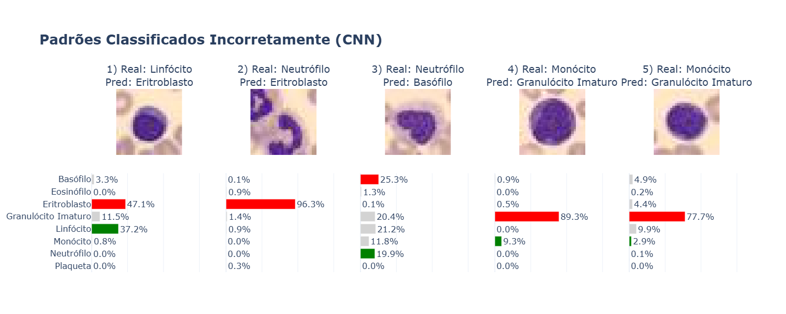

# IA048 - Atividade 3 - Redes Neurais Artificiais: MLPs e CNNs

Prof. Levy Boccato

**Aluno:** Rafael Campideli Hoyos (175100).

---

## Introdução

Para a realização da atividade foram usadas ferramentas python, destacando o uso de `PyTorch` [[2]](#referências) e `Scikit-Learn` [[3]](#referências) (para treino dos modelos e obtenção de métricas) e `Plotly` [[4]](#referências) (para plotagens de gráficos e tabelas). Os códigos e demais arquivos utilizados/confeccionados neste trabalho foram organizados em uma estrutura simplificada da *Cookiecutter Data Science* [[5]](#referências)  e estão disponíveis no *GitHub* no repositório [**TochaFh/IA048-ML-Atividades**](https://github.com/TochaFh/IA048-ML-Atividades) [[1]](#referências).

---

## Item A

Foi projetada uma MLP com exatamente uma camada oculta para classificar as 8 classes do BloodMNIST (imagens 28×28×3, partições oficiais de treino/validação/teste: 11.959/1.712/3.421). Cada configuração do grid de hiperparâmetros foi treinada por 20 épocas com Adam e entropia cruzada, e comparada pela acurácia balanceada na validação, métrica escolhida porque as classes são desbalanceadas.

O projeto da MLP pode ser resumido em duas tabelas: decisões / hiper parâmetros fixados e explorados.

#### Tabela -  Decisões Fixadas de Projeto (MLP):

| Configuração | Escolha / Valor | Justificativa |
| :--- | :--- | :--- |
| **Dimensão de Entrada** | $2352$ neurônios | Achatamento (*Flatten*) da imagem colorida de $28 \times 28 \times 3$ pixels. |
| **Pré-processamento** | Escalonamento em $[0.0, 1.0]$ | Divisão dos pixels por $255$. Mantém as entradas em faixa limitada, o que estabiliza a otimização com a inicialização padrão do PyTorch. Não foi aplicada normalização por média/desvio.|
| **Nº de Camadas Ocultas** | Exatamente $1$ camada | Exigência da atividade. |
| **Ativação Intermediária** | ReLU ($\max(0, x)$) | Não linearidade simples e barata, com gradiente 1 para x > 0, o que mitiga o desvanecimento de gradiente em relação a sigmoide/tanh. |
| **Camada de Saída** | $8$ neurônios (*Logits* brutos) | Corresponde às 8 classes de células sanguíneas, sem ativação no *forward*. |
| **Função de Custo** | Entropia Cruzada Multiclasse | Aplica o Softmax internamente com estabilidade numérica. |
| **Otimizador** | Adam | Algoritmo com taxas de aprendizado adaptativas e rápida convergência. |
| **Regularização $L_2$** | weight_decay = $10^{-4}$ | É o valor usual para o Adam no PyTorch (deve restringir a magnitude dos pesos e evitar *overfitting*) |
| **Taxa de Aprendizado ($\eta$)** | $10^{-3}$ | Em uma exploração preliminar, $10^{-4}$ teve um desempenho pior em todos os casos testados, provavelmente por convergência lenta em 20 épocas. Para reduzir o tamanho da busca, então, optou-se por fixar $10^{-3}$. |
| **Número de Épocas** | $20$ épocas | Compromisso entre custo computacional (12 configurações) e convergência com $\eta = 10^{-3}$. A melhor época é escolhida pela acurácia balanceada de validação. |
| **Tamanho do Lote (*Batch Size*)** | $64$ amostras | Lotes pequenos dão mais atualizações por época e o ruído do gradiente atua como regularização leve, o que favorece a convergência em apenas 20 épocas. |


### Tabela - Hiperparâmetros Explorados na Validação (MLP)

| Hiperparâmetro | Valores Candidatos | Propósito da Exploração |
| :--- | :--- | :--- |
| **Neurônios Ocultos ($N_{\text{oculta}}$)** | $\{128, 256, 512\}$ | Avaliar o impacto da capacidade de representação e complexidade da rede. |
| **Probabilidade de Dropout ($p$)** | $\{0.0, 0.2, 0.3, 0.5\}$ | Investigar o efeito da inativação aleatória de neurônios na generalização. |

#### Diagrama da MLP

Para melhor entender a MLP projetada veja o diagrama abaixo:



### Validação

A tabela e o gráfico mostram o desempenho das 12 configurações:
<div align="center">
  
  
</div>

\
A melhor configuração foi N_oculta = 512, dropout = 0 (acurácia balanceada de validação 0,8194). Observa-se que:

- **Dropout não ajudou:** Para as três larguras, p = 0 foi a melhor opção e p = 0,5 a pior, com queda grande (0,7048 para 512 e 0,6161 para 128). Isso sugere que, nesta faixa, o fator limitante é a capacidade do modelo e não o *overfitting*: desligar neurônios de uma camada já pequena reduz a capacidade efetiva sem trazer ganho de generalização perceptível.
- **O efeito da largura é menos claro.** Com p = 0, a acurácia cresce com N_oculta (0,7853 → 0,7915 → 0,8194), mas o salto de 128 para 256 é pequeno (0,6 p.p.) e a ordem se inverte em outros casos (com p = 0,3, a rede de 256 neurônios ficou abaixo da de 128). Como cada configuração foi treinada uma única vez e a validação tem 1.712 amostras, diferenças de poucos pontos percentuais não devem ser interpretadas como significativas. O destaque de 512/p = 0 (2,8 p.p. acima da segunda colocada) é o resultado mais robusto da busca, mas essa configuração está na borda do grid, então larguras maiores poderiam render um pouco mais.

### Teste

Utilizando os pesos do melhor modelo treinado (maior acurácia na validação), os seguintes resultados foram obtidos para o teste:

```txt
Acurácia Balanceada (Teste):    0.7953
F1-Score Macro (Teste):         0.7952
```



No teste, o modelo atingiu acurácia balanceada de **0,7953** e F1 macro de **0,7952** (acurácia simples ≈ 0,817). A queda em relação à validação (0,8194) é esperada: esse valor foi o máximo sobre épocas e configurações, logo é levemente otimista.

O desempenho varia bastante entre classes:

- **Melhores:** plaqueta (recall 99,4%), eosinófilo (92,3%), neutrófilo (85,4%) e linfócito (83,5%), classes com aparência mais distintiva (tamanho, cor, grânulos).
- **Piores:** basófilo (63,5%), monócito (67,6%) e granulócito imaturo (68,6%).

Os erros se concentram em torno do **granulócito imaturo**: 50 basófilos (20%) e 61 monócitos (21%) foram classificados como ele, e ele próprio foi confundido com monócito (64), basófilo (45) e neutrófilo (26); 51 neutrófilos também foram rotulados como granulócito imaturo. Por isso sua precisão é de apenas 64,6%. Biologicamente, essas classes diferem principalmente na forma do núcleo e na textura fina dos grânulos, informação espacial que se perde na resolução 28×28 e, principalmente, no achatamento (*flatten*), que descarta a vizinhança entre pixels. Isso motiva o uso de CNNs, que exploram localidade e compartilhamento de pesos.

---

## Item B

### Tabela - Decisões Fixadas de Projeto (CNN)

| Configuração | Escolha / Valor | Justificativa |
| :--- | :--- | :--- |
| **Formato de Entrada** | Tensor $3 \times 28 \times 28$ | Preserva a vizinhança espacial e os 3 canais RGB; diferentemente da MLP, a imagem não é achatada na entrada. |
| **Pré-processamento** | Escalonamento em $[0.0, 1.0]$ | Mesmo da MLP (divisão por $255$ via `ToTensor()`), para comparação direta. Sem normalização por média/desvio e sem aumento de dados. |
| **Nº de Camadas Convolucionais** | Exatamente $1$ camada | Exigência da atividade. |
| **Ativação** | ReLU ($\max(0, x)$) | Mesma justificativa do Item A: não linearidade simples, com gradiente 1 para $x > 0$. |
| **Padding** | *Same* ($P = \frac{k-1}{2}$) | Mantém $28 \times 28$ após a convolução para qualquer $k$. Assim, a entrada da camada densa ($K \cdot 14 \cdot 14$) depende só de $K$, e a comparação entre tamanhos de kernel isola o efeito do campo receptivo. |
| **Passo da Convolução** | $S = 1$ | Cada kernel percorre todas as posições, sem perder resolução antes do pooling. |
| **Pooling** | Max-Pooling $2 \times 2$ ($S = 2$) | Reduz $28 \times 28 \to 14 \times 14$, o que diminui em $75\%$ o número de ativações (e de pesos da camada de saída) e dá tolerância a pequenos deslocamentos. Janela pequena porque a imagem já tem baixa resolução. |
| **Camada de Saída** | Linear: $K \cdot 14 \cdot 14 \to 8$ *logits* | Sem camada densa intermediária: a camada convolucional é a única responsável pela extração de atributos. Sem Softmax no *forward*. |
| **Dropout** | Não utilizado | No Item A o dropout não trouxe ganho (melhor resultado com $p = 0$); a regularização fica a cargo do $L_2$. |
| **Função de Custo** | Entropia Cruzada Multiclasse | Igual ao Item A (Softmax interno, numericamente estável). |
| **Otimizador e $L_2$** | Adam, `weight_decay` = $10^{-4}$ | Mesmos do Item A; o valor de $L_2$ é o usual e não foi ajustado. |
| **Taxa de Aprendizado ($\eta$)** | $10^{-3}$ | Mesma do Item A. Não foi revalidada para a CNN. |
| **Tamanho do Lote** | $64$ amostras | Igual ao Item A, mantendo o mesmo número de atualizações por época. |
| **Número de Épocas** | $20$ épocas | Mesmo orçamento do Item A, para comparação justa entre as 18 configurações. Os pesos da melhor época (acurácia balanceada de validação) são restaurados. |

### Tabela - Hiperparâmetros Explorados na Validação (CNN)

| Hiperparâmetro | Valores Candidatos | Propósito da Exploração |
| :--- | :--- | :--- |
| **Quantidade de Kernels ($K$)** | $\{8, 16, 32, 64, 128, 256\}$ | Número de detectores de atributos aprendidos em paralelo (profundidade dos *feature maps*), que também define o tamanho da camada de saída ($K \cdot 196 \cdot 8$ pesos). Progressão em potências de 2, de uma representação mínima a uma bastante redundante. |
| **Tamanho do Kernel ($k \times k$)** | $\{3 \times 3, 5 \times 5, 7 \times 7\}$ | Escala do campo receptivo local: $\approx 10{,}7\%$, $17{,}9\%$ e $25{,}0\%$ da largura da imagem. Kernels pequenos tendem a captar detalhes finos (bordas, texturas) e maiores, estruturas mais amplas, o que será verificado nos resultados. Só valores ímpares, para que o *same padding* seja simétrico. |

Total: $6 \times 3 = 18$ configurações.

### Validação

<div align="center">
  
  
</div>

\
A melhor configuração foi $K = 256$, $k = 3 \times 3$ (acurácia balanceada de validação 0,9142). Observa-se que:

- **Todas as 18 CNNs superaram a melhor MLP:** a pior ($K = 8$, $k = 5$) obteve 0,8302. A melhor CNN tem ≈ 409 mil parâmetros, contra ≈ 1,21 milhão da melhor MLP. A vantagem vem do fato de a convolução levar em consideração a localidade, com compartilhamento de pesos, o que não ocorre na MLP.
- **Mais kernels ajudam, com retorno decrescente:** Para $k = 3$, a acurácia sobe de 0,8352 ($K = 8$) para 0,8793 ($K = 16$) e depois ganha só ≈ 0,7 a 1 p.p. a cada duplicação. Para $k = 5$ o ganho satura entre $K = 128$ e $256$ (0,9051 → 0,9066).
- **Kernels 3×3 e 5×5 têm desempenho muito próximo:** (diferença < 1 p.p. para $K \le 128$), com leve vantagem do 3×3 em $K = 256$.
- **O kernel 7×7 foi quase sempre pior** (para $K \ge 16$)**:** Não necessariamente melhora junto com o aumento de kernels, há um platô, aparentemente. Uma hipótese para isso é que filtros maiores (147 pesos por filtro, contra 27 do 3×3) favorecem *overfitting* ou suavizam detalhes finos em imagens de 28×28; comparar a acurácia de treino e de validação confirmaria isso.


- **Limite do grid e caminhos para melhorar:** O melhor resultado está na borda do grid ($K = 256$), então valores maiores de $K$ provavelmente renderiam um pouco mais. Entretanto, provavelmente esse não é o caminho mais indicado para melhorar o desempenho do modelo. O ganho por duplicação já é pequeno, enquanto o custo cresce linearmente com $K$ (a camada de saída passa de ≈ 100 mil parâmetros com $K = 64$ para ≈ 401 mil com $K = 256$). Alternativas que fogem da restrição de uma única camada convolucional, mas que tendem a ser mais eficientes, são empilhar mais camadas convolucionais (aumentando o campo receptivo efetivo com poucos parâmetros) e combinar kernels de tamanhos diferentes na mesma camada, no estilo Inception. Esta segunda opção é sugerida pelos próprios resultados: 3×3 e 5×5 têm desempenho parecido e o 7×7 só ajuda quando há poucos kernels, o que indica que escalas diferentes captam informação complementar.

## Item C


## Item C

A melhor configuração da busca ($K = 256$, $k = 3 \times 3$) foi retreinada do zero, com o uma seed no valor gerado aleatoriamente: 13. Este novo treino atingiu 0,9078 de acurácia balanceada na validação.

```
Acurácia Balanceada (Validação):    0.9078
```

O conjunto de teste foi avaliado uma única vez com esse modelo.

### Teste

A CNN obteve acurácia balanceada de **0,8892** e F1 macro de **0,8929** (acurácia simples ≈ 0,906). A queda de 1,9 p.p. em relação à validação é esperada, pois o modelo (época e configuração) foi escolhido pela própria validação. Vale notar que a execução da busca, com a mesma configuração, havia obtido 0,9069 no teste: as métricas têm variabilidade de ≈ 1 a 2 p.p. entre execuções, e os resultados aqui são de uma única execução.

```txt
Acurácia Balanceada (Teste):    0.8892
F1-Score Macro (Teste):         0.8929
```



| Classe | Precisão | Recall | F1 |
| :--- | :---: | :---: | :---: |
| Basófilo | 0,870 | 0,881 | 0,876 |
| Eosinófilo | 0,962 | 0,979 | 0,971 |
| Eritroblasto | 0,891 | 0,923 | 0,907 |
| Granulócito Imaturo | 0,762 | 0,845 | 0,801 |
| Linfócito | 0,879 | 0,893 | 0,886 |
| Monócito | 0,886 | 0,655 | 0,753 |
| Neutrófilo | 0,969 | 0,940 | 0,954 |
| Plaqueta | 0,994 | 0,998 | 0,996 |

As classes mais fáceis são plaqueta (recall 99,8%), eosinófilo (97,9%) e neutrófilo (94,0%). O ponto mais fraco é o **monócito**, com recall de apenas 65,5%: 83 das 284 amostras (29%) foram classificadas como granulócito imaturo, enquanto o erro inverso é bem menor (18 granulócitos imaturos classificados como monócito). Ou seja, a rede tem viés de "atrair" para o granulócito imaturo, que tem a menor precisão (76,2%). Os erros desse último são espalhados: basófilo (20), monócito (18), eritroblasto (14), linfócito (14) e neutrófilo (13), e basófilos, linfócitos e neutrófilos também foram confundidos com ele (20, 17 e 18). Ao todo, ≈ 76% dos 321 erros envolvem o granulócito imaturo, como classe real ou predita.

### Padrões classificados incorretamente



Os erros mostram comportamentos distintos da rede:

- **Erros confiantes (2, 4 e 5):** a rede atribui 96%, 89% e 78% à classe errada, e à classe real quase nada (≈ 0%, 9% e 3%). O Softmax, portanto, não é um bom indicador de incerteza: a rede pode errar com convicção.
- **Erros ambíguos (1 e 3):** no 1, a probabilidade se divide entre eritroblasto (47%) e linfócito (37%), duas células pequenas de núcleo redondo e denso. No 3, a distribuição é praticamente plana, com cinco classes entre 12% e 25% (basófilo, linfócito, granulócito imaturo, neutrófilo e monócito), o que indica que a rede não identificou a classe.

Visualmente, a amostra 2 mostra uma célula fora do centro, com lobos do núcleo cortados nas bordas da imagem, e a amostra 3 tem núcleo em formato de incomum, sem a segmentação típica de um neutrófilo maduro. Nas amostras 4 e 5 o núcleo é grande, arredondado e sem o típico "*gap*" visível, o que pode explicar a confusão com o granulócito imaturo.

Em resumo, os erros restantes se concentram em classes morfologicamente próximas, em que a diferença está em detalhes finos do núcleo e da cromatina, que a resolução de 28×28 preserva mal, além de amostras mal centradas ou ambíguas. Melhorar o desempenho exigiria modelos mais expressivos (mais camadas, múltiplas escalas) ou maior resolução.

---

## Referências

1. TochaFh/IA048-ML-Atividades (repositório com as atividades na disciplina IA048 em 2s2026) https://github.com/TochaFh/IA048-ML-Atividades
2. Paszke et al., PyTorch: An Imperative Style, High-Performance Deep Learning Library, NeurIPS 2019.
3. Scikit-learn: Machine Learning in Python, Pedregosa et al., JMLR 12, pp. 2825-2830, 2011. https://scikit-learn.org/stable/
4. Plotly-express. https://plotly.com/python/plotly-express/
5. Cookiecutter Data Science. https://cookiecutter-data-science.drivendata.org/
6. Yang et al., MedMNIST v2, Scientific Data, 2023